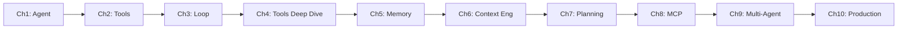

# Agent 101: Building AI Agents from Scratch

A hands-on course in AI agent engineering, built bottom-up with no frameworks
(no LangChain, no CrewAI, no AutoGen). Every chapter is runnable code plus a
doc explaining what the code does and why.

## Philosophy

You cannot understand what a framework does for you until you have built
the thing the framework replaces. Every chapter here is small enough to
read top to bottom in one sitting.

## Setup

```bash
python3 -m venv venv
source venv/bin/activate
pip install anthropic mcp
export ANTHROPIC_API_KEY=your_key_here
```

Each chapter is self-contained: `cd chapterN_*/ && python3 <file>.py`

## Map

| Chapter | Topic | Core question it answers |
|---|---|---|
| 1 | What is an Agent? | How is an agent different from a chatbot or a script? |
| 2 | Tools | How does an LLM "act" on the world? |
| 3 | The Agent Loop | How does an agent take more than one step? |
| 4 | Tools in Depth | How do you make tool use *reliable*? |
| 5 | Memory | How does an agent remember across turns and sessions? |
| 6 | Context Engineering | What exactly goes into each LLM call, and why? |
| 7 | Planning | How does an agent break a goal into subtasks? |
| 8 | MCP | How do agents talk to tools via a standard protocol? |
| 9 | Multi-Agent Systems | When and how do multiple agents cooperate? |
| 10 | Production Agent Engineering | What does it take to run this safely at scale? |

## Progression



Read each chapter's `README.md` first, then its `.py` file(s), then run it.
