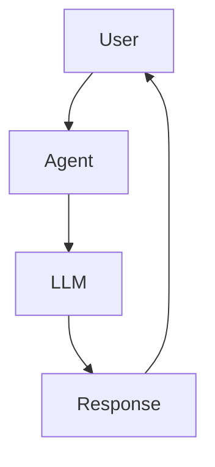

# Chapter 1 — What is an Agent?

## Concept

An **LLM** is a stateless function: text in, text out. No memory between
calls, no ability to act on the world, no loop.

An **LLM application** wraps that function with a nicer interface (chat UI,
prompt templates) — but it's still one call in, one response out.

An **Agent** runs the LLM in a **loop** and gives it the ability to trigger
real actions (tool calls), then feeds results back in. The model isn't
smarter inside an agent — the system around it changed.

- **Agent vs chatbot**: chatbot maps input to output. Agent maps input to
  (N internal steps, self-decided) to output.
- **Agent vs workflow**: a workflow is a fixed sequence a human designed.
  An agent decides its own next step at runtime.
- **Agent vs traditional software**: traditional software branches on
  `if/else` a programmer wrote. An agent's branching is implicit, whatever
  the LLM decides given current context.

## Mental Model

The LLM is a well-read intern who can only communicate via memos: no
browser, no code execution, no calculator. An agent is the process you
build around that intern: hand it a memo, it writes back what it wants to
do next, your code does it, hands the result back.

## Architecture



No loop, no tool yet. This chapter is pure plumbing. Get this working
before adding capability.

## Run it

```bash
python3 agent.py
```

## Experiment

1. Run as-is.
2. Ask it something needing real computation: `"What is 847293 * 9384?"`.
   Watch it guess. This is the exact gap Chapter 2 (tools) fixes.
