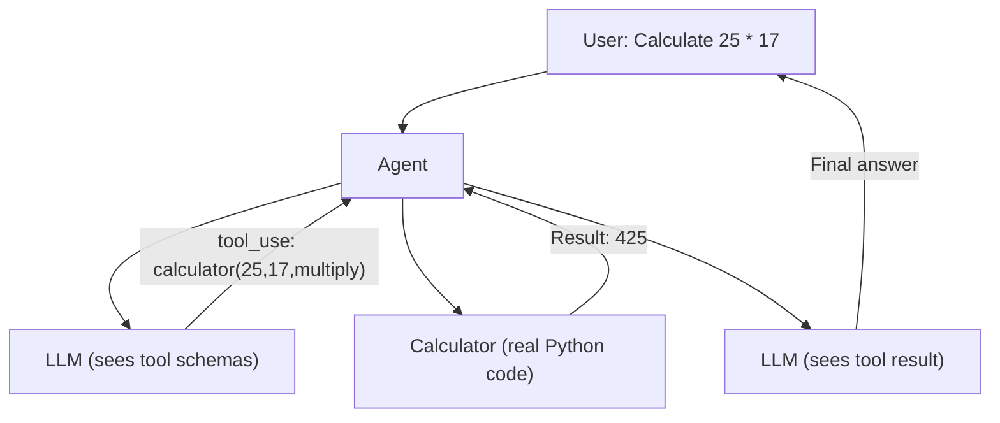

# Chapter 2 — Give the Agent a Tool

## Concept

The LLM can't reliably do arithmetic, check live weather, or query a
database — it can only pattern-match what an answer *looks like*.

**Tool calling** is a protocol: you describe functions the model may
request ("here's a schema: name, description, arguments"). The model
never executes anything. It emits structured text ("call `calculator`
with `{a:25, b:17, op:'multiply'}`"). Your code reads that, actually runs
the function, and feeds the result back as new context.

The single most important fact in this chapter: **the model never runs
code**. It only ever emits a request. Your process is the one with hands.

## Mental Model

Give the intern a request form: "if you need arithmetic, fill this out
and I'll run it on the calculator and bring back the result." The intern
still can't touch the calculator — they just know the form exists.

## Architecture



Notice: **two LLM calls**, not one. Call 1 decides to use a tool. Your
code runs the tool. Call 2 produces the final answer using the result.

## Key terms

- **Tool schema**: JSON Schema description of a function's name,
  purpose, and arguments. The model only ever sees this, never your code.
- **Arguments**: a dict the model generated matching your schema. Never
  assume it's safe (Chapter 4 covers validation).
- **Tool result**: what you send back, tagged with `tool_use_id` so the
  model knows which call it answers.
- **Why the LLM can't execute it itself**: it has no runtime, filesystem,
  or network access. It is a text predictor.

## Run it

```bash
python3 agent_with_tool.py
```

## Experiment

1. Ask something needing no tool (`"What's the capital of Japan?"`) and
   confirm the tool is skipped (`stop_reason != "tool_use"`).
2. Ask `"What is 5 plus 3, then multiplied by 2?"` and watch whether it
   calls the tool once or twice. This is your first glimpse of multi-step
   tool use — the subject of Chapter 3.
