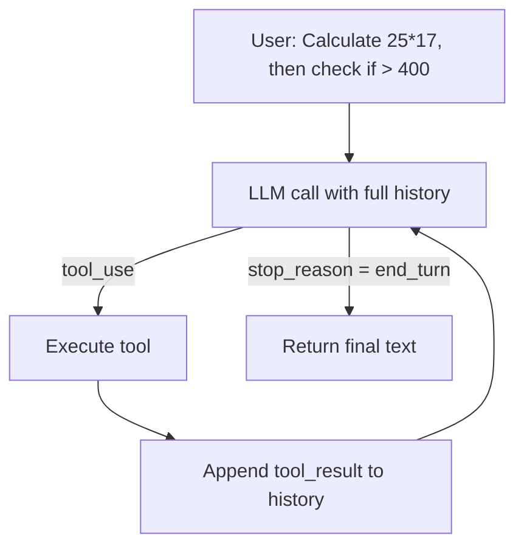

# Chapter 3 — The Agent Loop

## Concept

Chapter 2's code hardcodes "call 1, maybe one tool, call 2, done." That
breaks the moment a task needs more than one tool call. The fix is a real
loop that keeps going until the model itself says it's done:

```
OBSERVE -> THINK/DECIDE -> ACT -> OBSERVE RESULT -> THINK/DECIDE -> ACT -> ... -> FINAL ANSWER
```

- **OBSERVE**: current context (conversation + tool results so far)
- **THINK/DECIDE**: one LLM call, produces a tool request or a final answer
- **ACT**: your code executes the requested tool
- Repeat until the model stops requesting tools

This loop shape is the same one underneath almost every agent framework
you'll ever use.

## Mental Model

Instead of one memo exchange, an ongoing back-and-forth: intern writes a
memo, you act on it, you write back with results, intern reads that and
writes another memo (maybe requesting another action), repeat until the
memo says "here's the final answer" instead of "please run this."

## Architecture



The structural change from Chapter 2: this is a `for`/`while` loop, not
two fixed calls.

## Why `max_steps` exists

Without a cap, a model that keeps deciding "one more tool call" loops
forever, burning tokens and money. Every real agent has a step limit,
timeout, or cost budget — this is a first, crude version of the
guardrails covered properly in Chapter 10.

## Run it

```bash
python3 agent_loop.py
```

## Experiment

1. Run as-is — confirm two loop iterations in the printed trace.
2. Add an `is_even_or_odd(n)` tool + schema and ask a 3-step question.
3. Set `max_steps=1` and rerun — watch it hit the "max steps" fallback.
   This is a real failure mode, not a hypothetical one.
