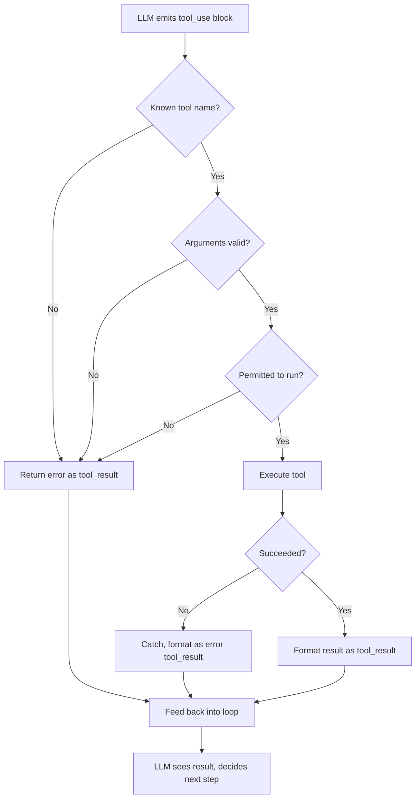

# Chapter 4 — Tools, In Depth

## Concept

A toy tool handles only the happy path. A production tool handles nine
things:

- **Function calling** — the umbrella term for "LLM emits structured
  intent to invoke a function." No deeper magic than what Chapter 2 built.
- **Tool schemas** — a contract, not a suggestion. The model only knows
  what your `description` and `input_schema` say. Vague description ->
  wrong tool selection, regardless of model quality.
- **Tool discovery** — how the model learns which tools exist. Here: you
  hardcode the full list into every request. At scale (hundreds of tools)
  this itself becomes a problem — too many tools in context hurts
  selection accuracy. MCP (Chapter 8) partially addresses this.
- **Tool selection** — which tool, among several. Overlapping tool
  purposes cause real bugs (two similarly-described tools -> wrong pick).
- **Tool arguments** — model-generated, not user-generated. Never assume
  they're safe or even schema-valid.
- **Tool execution** — your code, running with model-supplied input. This
  is the actual trust boundary.
- **Tool results** — errors need to be fed back too, not swallowed. The
  model can often self-correct if told a call failed and why.
- **Errors & retries** — a naive agent crashes on a bad call. A real one
  catches the error, returns it as the tool result, and lets the model
  decide whether to retry with different arguments.
- **Tool permissions & validation** — you decide what a tool may do, and
  validate arguments before running them. Model output is untrusted input,
  exactly like any other user input.

## Mental Model

The intern's form can be filled out wrong (malformed JSON), can request a
form that doesn't exist (unknown tool), can describe something dangerous
(delete all files), or the action itself can fail (calculator breaks). A
production agent handles all four without crashing; a toy one only
handles the first.

## Architecture — full tool lifecycle



Every exit path leads back into the loop. The model always gets
*something* back — silent failure is what causes agents to hang or
hallucinate a result.

## Run it

```bash
python3 toolkit.py
```

## Experiment

1. Run as-is — divide-by-zero is handled gracefully and fed back as an
   error the model can react to.
2. Ask it to call a tool that doesn't exist. Watch `execute_tool` catch
   it as `unknown tool` — this is why the permission check matters more
   than a system-prompt instruction.
3. Remove the `try/except` in `execute_tool` and rerun the divide-by-zero
   case. Watch it crash. Put it back once you've seen the failure.
