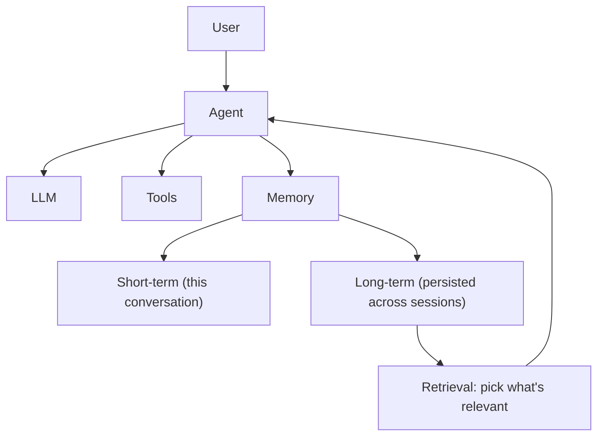

# Chapter 5 — Memory

## Concept

Every agent you've built so far has amnesia: call `agent()` twice, the
second call knows nothing about the first. Real agents distinguish
several kinds of memory:

- **Conversation history** — the raw list of messages in the current
  session. This is what you've been passing to `messages=` all along.
- **Short-term / working memory** — the subset of conversation history
  actually kept in context right now. As conversations grow, you can't
  keep everything (context limits, cost) — you truncate, summarize, or
  select.
- **Long-term memory** — information that persists *across* sessions:
  facts about the user, past decisions, preferences. This lives outside
  the context window, in some storage layer, and gets *retrieved* into
  context when relevant.
- **External memory / vector databases** — one common implementation of
  long-term memory: store text as embeddings, retrieve the
  most-similar chunks to the current query (semantic search) instead of
  keyword search.

The critical distinction: conversation history is automatically in
context because you pass it every call. Long-term memory is NOT
automatically in context — something has to decide what's relevant and
inject it. That decision process is memory *retrieval*, and it's a real
design problem, not a solved one.

## Mental Model

Short-term memory is what's on your desk right now. Long-term memory is
the filing cabinet down the hall — you don't carry the whole cabinet to
your desk, you go get the one folder you need when you need it.

## Architecture



## What this chapter builds

Two files:
- `memory.py` — a minimal long-term memory store: a JSON file on disk,
  with naive keyword-based retrieval (no embeddings yet — that's a real
  upgrade path, not required to understand the concept).
- `agent_with_memory.py` — an agent that, before each turn, retrieves
  relevant long-term facts and injects them into context, and after each
  turn, decides whether anything worth remembering was said.

## Run it

```bash
python3 agent_with_memory.py
```

## Experiment

1. Run it, tell it your name and a preference, then exit and rerun the
   script (a fresh process). Ask "what's my name?" — it should recall it
   from `memory.json` on disk, proving this survived the process boundary.
2. Look at `memory.json` after a run — this is long-term memory made
   visible, not an abstraction.
3. Replace the keyword-match retrieval in `memory.py` with something
   smarter (even simple TF-IDF) and see how retrieval quality changes.
