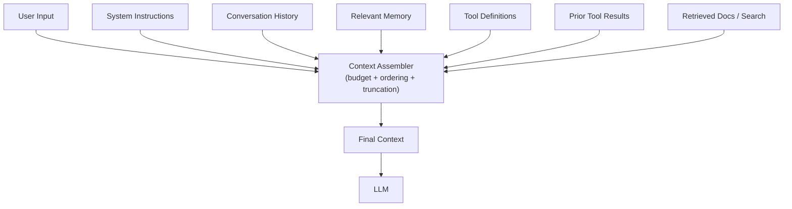

# Chapter 6 — Context Engineering

## Concept

Every LLM call in this repo so far has quietly assembled context from
several sources without naming the process. Context engineering is the
explicit discipline of deciding what goes into that context window,
in what order, and why:

```
User Input
+ System Instructions
+ Conversation History
+ Relevant Memory      (Chapter 5's retrieve())
+ Tool Definitions     (Chapter 2/4's schemas)
+ Tool Results         (Chapter 3/4's tool_result blocks)
+ Retrieved Information (search results, docs, RAG chunks)
        v
      Context
        v
       LLM
```

This matters because:
- Context windows are finite. You cannot include everything, always.
- Irrelevant context degrades output quality, not just cost — models
  perform worse when forced to sift through noise.
- Ordering and framing affect how the model weighs information (recent
  and clearly-labeled content tends to get more attention).
- Every previous chapter's design decision (what to retrieve, when to
  summarize, what schema to expose) IS context engineering — this
  chapter just makes the practice explicit and inspectable.

## Mental Model

Context engineering is like packing a suitcase with a strict weight
limit for a trip whose itinerary keeps changing. You don't pack
everything you own — you decide, deliberately, what's relevant for the
next leg of the trip, and you repack before each leg.

## Architecture



## What this chapter builds

`context_builder.py` implements an explicit `ContextBuilder` that:
- tracks a token budget (approximate),
- assembles context from named sources in priority order,
- truncates conversation history (oldest first) when the budget is
  exceeded, rather than silently sending an oversized request.

## Run it

```bash
python3 context_builder.py
```

## Experiment

1. Feed it a long fake conversation history and a small `max_tokens`
   budget. Watch which parts get dropped, and confirm system
   instructions and the current user input are *never* dropped, only
   older history.
2. Change the priority order (e.g. drop tool results before history) and
   observe how that changes what survives truncation.
3. Add a genuinely irrelevant "retrieved document" and a genuinely
   relevant one, and notice you (not the model) decided which to include
   — that decision is the actual engineering work.
