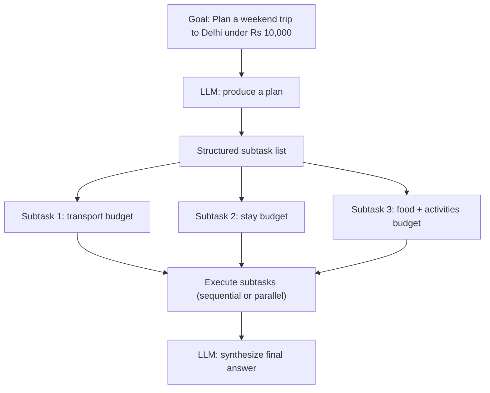

# Chapter 7 — Planning

## Concept

Distinguish five things people conflate:

- **Simple tool calling** — one decision, one action (Chapter 2).
- **Reasoning** — the model working through implications in its own
  output before acting, still fundamentally single-step-at-a-time.
- **Planning** — the model produces an explicit, structured breakdown of
  a goal into subtasks *before* executing any of them.
- **Task decomposition** — the mechanics of planning: splitting "plan a
  weekend trip" into "find dates", "find transport", "find stay", etc.
- **Sequential vs parallel execution** — once you have subtasks, do they
  depend on each other's output (sequential) or not (parallel, faster)?

The Chapter 3 loop is *reactive*: decide one step, act, observe, decide
the next step, with no upfront view of the whole path. Planning adds a
deliberate step where the model commits to a structure first, which you
can inspect, validate, or even show the user before any execution begins.

## Mental Model

The Chapter 3 loop is like walking through a maze one turn at a time,
deciding at each junction. Planning is stopping first to sketch a route
on paper, then walking it (and re-planning if a step reveals a wall you
didn't expect).

## Architecture



## What this chapter builds

`planner_agent.py` implements two phases explicitly:
1. **Plan phase** — one LLM call asks the model to output a JSON list of
   subtasks (no tools, no execution yet — just structure).
2. **Execute phase** — each subtask is run through the Chapter 3 agent
   loop (with mock budget-lookup tools), sequentially, since each
   subtask here depends on a shared budget constraint.
3. **Synthesis phase** — one final LLM call combines all subtask results
   into a coherent answer.

## Run it

```bash
python3 planner_agent.py
```

## Experiment

1. Run it on `"Plan a weekend trip to Delhi under Rs 10,000."` and read
   the printed plan before execution starts — that visibility is the
   entire point of separating planning from execution.
2. Change the goal to something with independent subtasks (e.g. "tell me
   the weather in Delhi and Mumbai") and modify the executor to run
   those two subtasks in parallel using threads — notice sequential
   only made sense above because of the shared budget dependency.
3. Deliberately give the planner a vague goal ("plan my week") and see
   how it decomposes — this exposes how much planning quality depends on
   goal specificity, same as it would for a human given a vague brief.
