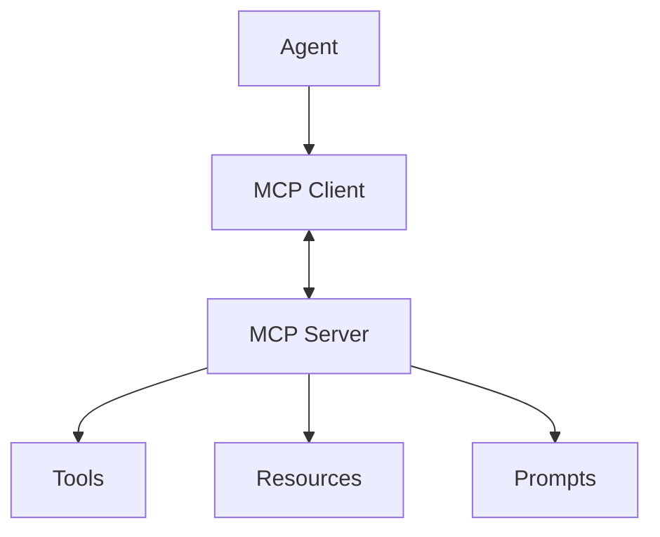

# Chapter 8 — Model Context Protocol (MCP)

## Concept

Every prior chapter hardcoded tool schemas and execution directly into
the agent's own code (`TOOLS = {...}`, `tool_schemas = [...]`). That
works for one agent with a handful of tools. It breaks down when:

- you want the SAME tools usable by multiple different agents/apps,
- tools live on someone else's server (a company's internal systems,
  a SaaS product) and you shouldn't need their source code to use them,
- you want to add/remove tools without redeploying the agent itself.

**MCP (Model Context Protocol)** standardizes the interface between an
agent (MCP *client*) and a tool provider (MCP *server*), so any
MCP-compatible agent can use any MCP-compatible server without custom
integration code. It's the same idea as "USB" for tools: one connector
shape, many devices.

An MCP server exposes three kinds of things:
- **Tools** — functions the agent can call (like everything in Ch. 2-4).
- **Resources** — data the agent can read (files, records, docs) without
  necessarily "calling" anything — more like a GET than a POST.
- **Prompts** — reusable prompt templates the server provides.

## Mental Model

Before MCP: every agent has its calculator wired directly into its own
body — great until you need ten agents to share one calculator, or the
calculator is a black box owned by someone else. MCP is a standard
socket: any agent (client) plugs into any tool server the same way,
regardless of who built either side.

## Architecture



## What this chapter builds

A REAL, runnable MCP server (`mcp_server.py`) using the official `mcp`
Python SDK, exposing:
- a `calculator` tool,
- a `get_time` tool,
- a `notes://latest` resource (a piece of readable data),
- a `trip_planner` prompt template.

And a client agent (`mcp_client_agent.py`) that:
1. launches the server as a subprocess over stdio (MCP's standard local
   transport),
2. discovers its tools dynamically (no hardcoded `tool_schemas` list —
   this is the tool discovery problem from Chapter 4, solved by MCP),
3. converts the discovered MCP tool schemas into Anthropic API tool
   schemas,
4. runs a normal Chapter 3-style agent loop, but every tool call is
   dispatched over MCP to the server process instead of a local Python
   function.

## Install

```bash
pip install mcp anthropic
```

## Run it

```bash
python3 mcp_client_agent.py
```

This starts the server as a subprocess automatically — you do not run
`mcp_server.py` directly.

## Experiment

1. Run it and watch the printed tool discovery step — the client never
   hardcodes what tools exist, it asks the server at startup.
2. Add a new tool to `mcp_server.py` (e.g. `reverse_string`) and rerun
   the client WITHOUT changing any client code. Confirm it's
   automatically discovered and usable.
3. Read the `notes://latest` resource from the client side (see the
   commented-out `read_resource` example) and compare "reading a
   resource" to "calling a tool" — notice a resource has no arguments,
   it's just data to fetch.
