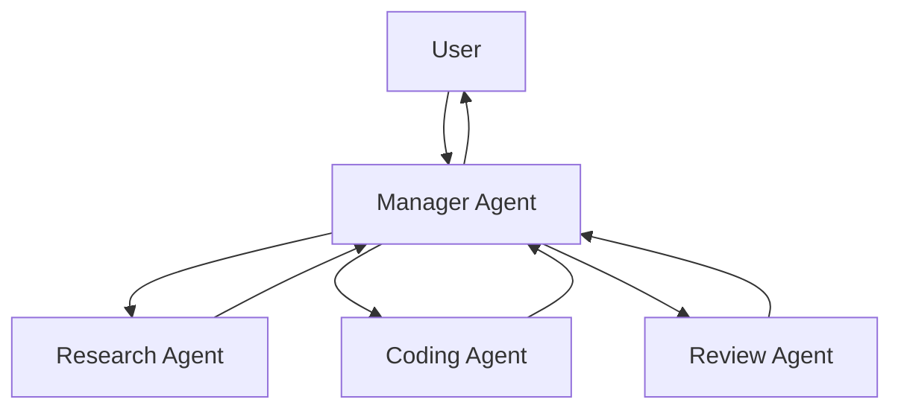

# Chapter 9 — Multiple Agents

## Concept

Every prior chapter used ONE agent. Multi-agent systems introduce
several agents, each with a narrower role, coordinated by something
(a manager agent, a fixed pipeline, or peer-to-peer messages).

```
                 +-- Research Agent
User -> Manager -+-- Coding Agent
                 +-- Review Agent
```

**Why multiple agents?**
- Separation of concerns: a narrowly-scoped agent (with a focused system
  prompt and a small tool set) is more reliable than one agent trying to
  do everything.
- Parallelism: independent subtasks can run concurrently.
- Specialization: different agents can use different models, tools, or
  even different prompting strategies suited to their sub-role.

**When NOT to use multiple agents:**
- The task is simple enough for one agent's loop (Chapter 3) — added
  coordination overhead buys you nothing.
- Subtasks are tightly coupled and need constant shared context — passing
  state between agents is lossy and adds latency compared to one agent
  with full context.
- You can't clearly define each agent's boundary — vague role split leads
  to duplicated or dropped work.

**Core mechanics:**
- **Agent-to-agent communication** — usually just... text. One agent's
  output becomes another's input. No exotic protocol required.
- **Shared context** — what the manager passes down to each sub-agent
  (and what it does NOT pass, to keep each sub-agent focused — this is
  Chapter 6's context engineering applied at the multi-agent level).
- **Delegation & orchestration** — the manager decides which sub-agent
  handles what, and in what order.
- **Sequential vs parallel agents** — same distinction as Chapter 7's
  subtasks, now applied to whole agents instead of tool calls.

## Mental Model

One agent trying to research, write code, and review its own code is
like one person doing all three jobs with no separation — they will
under-review their own work. Multiple agents is hiring a researcher, a
coder, and a reviewer, and having a manager assign and sequence the work.

## Architecture



## What this chapter builds

`multi_agent.py` implements exactly this: a Manager that, given a coding
task, calls a Research sub-agent (mock web-lookup tool), then a Coding
sub-agent (writes a function), then a Review sub-agent (critiques the
code), then synthesizes a final answer. Each sub-agent is just a Chapter
1-style single-purpose LLM call with its own system prompt — no new
mechanism, only role separation and sequencing.

## Run it

```bash
python3 multi_agent.py
```

## Experiment

1. Run it on the default task and read each sub-agent's output
   separately in the trace — notice each one only sees what the manager
   chose to hand it, not the full history.
2. Add a "Test Agent" that writes a unit test for the Coding agent's
   output, and slot it between Coding and Review.
3. Try running Research and Coding in parallel (they're independent
   here) using `asyncio.gather` or threads, and only run Review after
   both finish — this is the sequential-vs-parallel decision from
   Chapter 7, now at the agent level.
